# Explorer PowerPane


A folder sidebar for Windows File Explorer. PowerPane embeds a pinned-folders pane inside every Explorer window, so your groups, recent locations, drives, network shares, and WSL distros travel with the window you are already using. Pin it inside the window, float it beside the window, or run it as a slim screen-edge dock. Everything runs locally as a single tray app, no code is ever injected into Explorer, and all data stays in plain files under your user profile.

## Download

**[Download the installer](https://github.com/prisant-labs/windows-explorer-powerpane/releases/latest/download/PowerPane-x64-setup.exe)** (always the newest version), or open the [latest release](https://github.com/prisant-labs/windows-explorer-powerpane/releases/latest) for the `.zip`, which holds only the program and its license, with no right-click verb or startup entry. [Installation](#installation) has the details.

[](https://github.com/prisant-labs/windows-explorer-powerpane/releases/latest)

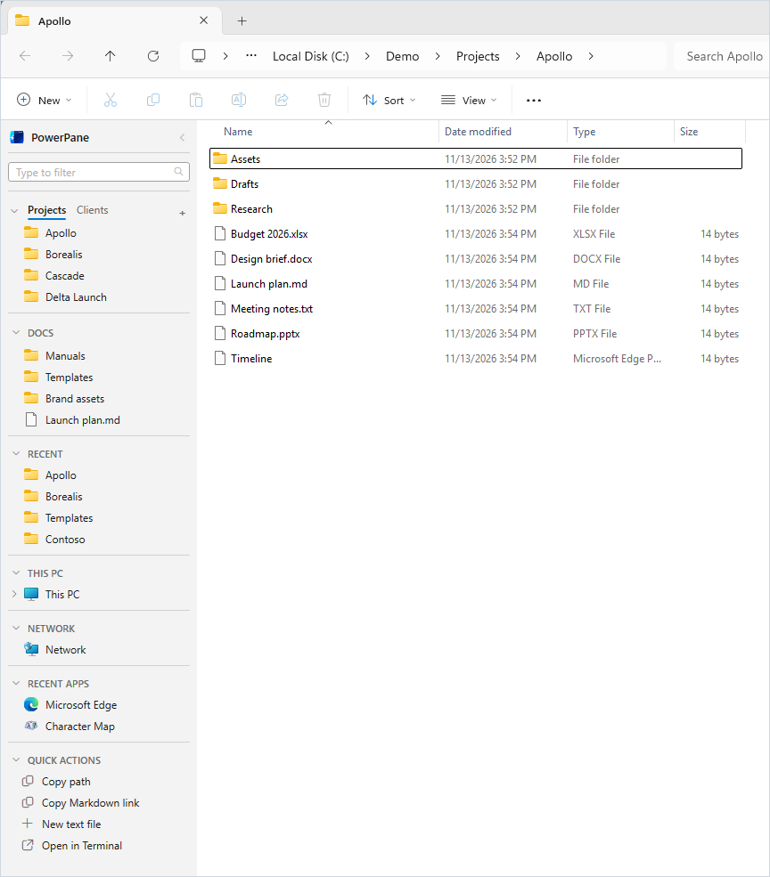

PowerPane began as a fork of [QuickPane](https://github.com/lso2/QuickPane) by lso2 (PlexPixel), released under the MIT license. It is developed here under its own name, and [CHANGELOG.md](CHANGELOG.md) lists every version since.

## What's new

<!-- Keep the three newest releases here, one line each, and replace "Next release" with its version and date when tagging. CHANGELOG.md holds every version. -->

- **Next release**: the **Add to PowerPane** verb works on files and drives as well as folders, and it lets you choose a tab. A **+** menu on each group adds a tab, a group, a folder, or a file, and **Sort pins** keeps a tab in order by itself.
- **4.0.0.1** (2026-11-12): the pane inside Open and Save dialogs no longer pushes the dialog's search box off the edge, and dragging the pane's width works there.
- **4.0.0.0** (2026-11-11): QuickPane became Explorer PowerPane, with a new name, a new icon, and a new install location. The [release notes](docs/releases/4.0.0.0.md) describe moving your groups across.

[Full changelog](CHANGELOG.md)

## Summary

PowerPane puts your folders one click away inside Explorer itself, with:

- 📁 **Inside, beside, or dock**: embed the pane in each Explorer window and shift its content, float a follower pane at the window's edge, or run dock-only
- 🗂️ **Pinned folder groups**: organize folders into groups and tabs, backed by real folders and shortcuts on disk
- 🕘 **Real Recent**: it tracks the folders you actually browse in Explorer, not only the ones clicked inside the pane
- 🖥️ **This PC, Network, and Linux**: expandable drives and lazy folder trees, plus Network and WSL sections
- 🪟 **Stays at the window's z-level**: the beside pane is an owned window of its Explorer window, never forced above everything else
- 📌 **Desktop dock**: an optional screen-edge AppBar on the left or right edge of a display, with auto-hide and all-virtual-desktops pinning
- 💾 **Open and Save dialog support**: the pane attaches to file dialogs and navigates them too
- 🔎 **Search box**: filters every folder in the pane as you type
- 🚀 **Recent Apps**: the programs you have been using, where a row opens its app and browser rows open out into their profiles
- ⚡ **Quick actions**: copy a path in several formats, create a starter file, open a terminal, run your own commands, and act on the files selected in Explorer
- 🎯 **Per-app folders**: set a folder as an app's starting point and its Save and Open dialogs land there
- 👤 **Profiles**: independent workspaces, each with its own groups, recents count, and width
- 🎨 **Native feel**: dark and light themes that blend into the Windows shell
- 🔒 **Local storage**: groups are folders of shortcuts and settings are a JSON file you can back up

## Features

### Inside, beside, and dock modes

Three ways to show the pane, chosen in Settings:

- **Inside** reparents the pane into each Explorer window and shifts the file view to the right to make room, so the pane reads as part of the window.
- **Beside** floats a follower pane against the left edge of each window without shifting its content. The pane is an owned window of its Explorer window, so Windows keeps it at that window's z-level, on that window's virtual desktop, and hides it when the window is minimized.
- **Off** uses only the desktop dock and leaves Explorer windows untouched.

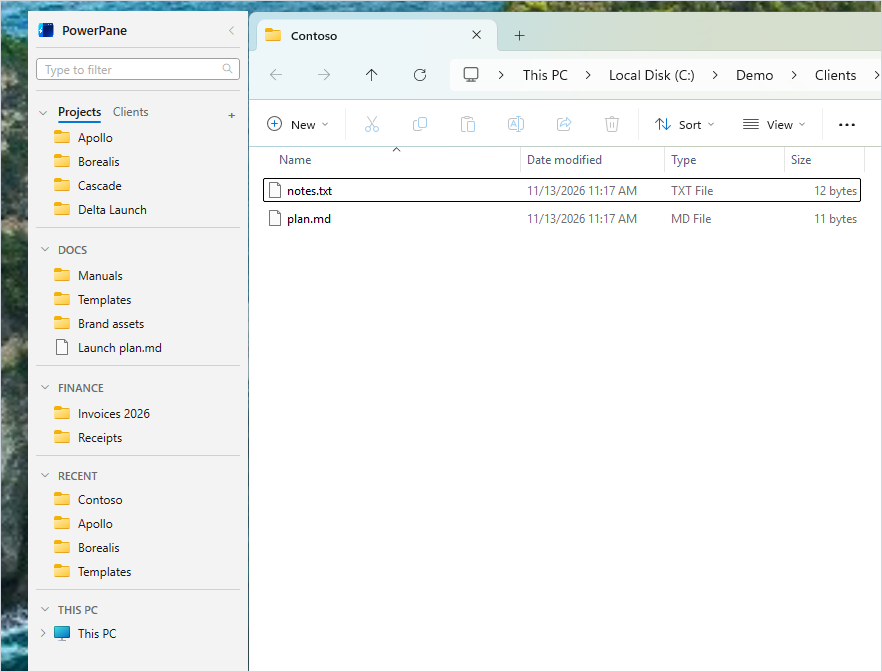

### Pinned folder groups

Folders live in groups, and a group can hold several tabs.

- Add a folder or file with the **Add to PowerPane** context-menu verb on any folder, file, or drive, on a folder's background, or by dragging it into the pane. On Windows 11 the verb is under "Show more options", or press Shift+F10 on the item
- Create, rename, and delete groups, tabs, and pins
- Drag to reorder groups, tabs, and pins, with a visible drop line while reordering
- Drag one group onto another to merge their tabs, or drag a tab into empty space to make it a new group
- Sort a tab's pins A to Z or newest first, once or kept sorted, from **Sort pins** in its right-click menu
- A group with a single tab renders like a plain list; with several tabs it shows a horizontally scrollable tab row
- A seeded default group appears on first run so the pane is never empty

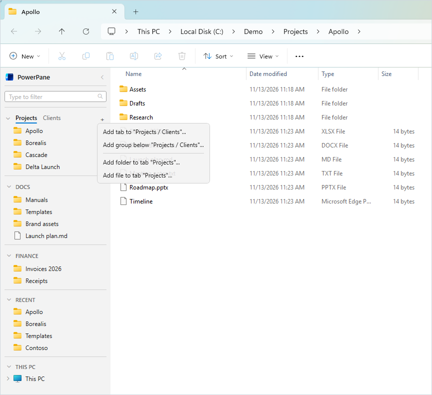

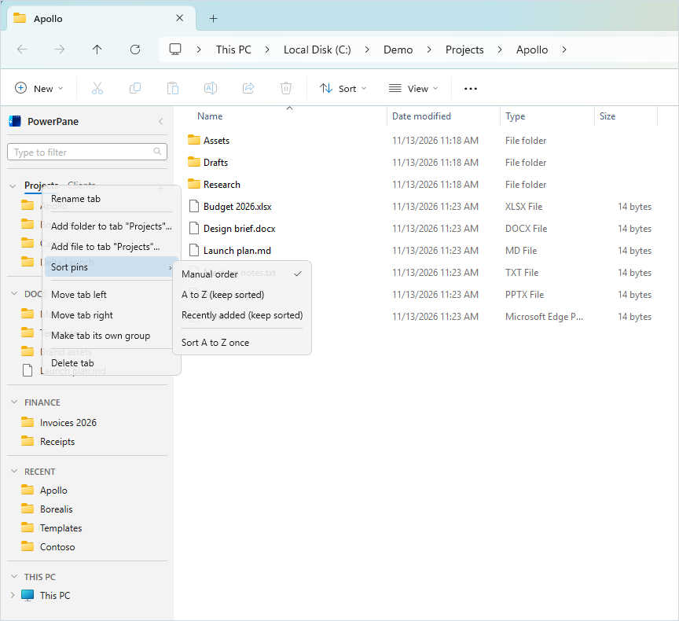

### Sections

The pane is a stack of sections you can show, hide, reorder, and rename:

- **Search box**: filters the rows already on screen as you type, so it stays instant however many groups are pinned
- **App Folders**: inside a file dialog, the folder you set as that app's starting point
- **Groups**: your pinned folder groups
- **Recent**: folders browsed directly in Explorer, captured through window activation, title changes, and a light periodic check, with a location-URL fallback when the shell returns nothing, and a configurable count from 5 to 50. Folders you choose never appear there, and Clear Recent empties it without touching Windows' own Recent list
- **This PC**: a This PC row that opens the folder and expands to the drives, each drive expanding into subtrees that enumerate lazily like the native Explorer tree
- **Network** and **Linux (WSL)**: each its own section with a proper icon and a visibility toggle
- **Recent Apps**: the programs you have been using, each opening its app

### Native file drag

Drag files from Explorer onto a pinned folder to file them. Dropping moves on the same drive and copies across drives, while Ctrl forces a copy, Shift forces a move, and Alt creates a shortcut. The operation runs through the shell, so progress, conflicts, and undo behave exactly as they do in Explorer.

### Desktop dock

An optional AppBar at the left or right screen edge, independent of the window pane.

- Auto-hide collapses it to a thin strip that slides out on hover
- A setting shows it on every virtual desktop instead of only the one it opened on
- On a multi-monitor computer, a Display setting picks which monitor it sits on; "Primary display" (the default) tracks whichever monitor Windows currently calls primary, and a specific choice falls back to Primary display if that monitor is ever disconnected ([#146](https://github.com/prisant-labs/windows-explorer-powerpane/issues/146))
- An Edge setting puts it on the left (the default) or right edge of its display. On an edge shared with another display, auto-hide waits briefly before opening, so crossing between displays does not open it ([#177](https://github.com/prisant-labs/windows-explorer-powerpane/issues/177))
- Clicking a folder navigates the active Explorer window and brings it forward, or opens a new window when none is open

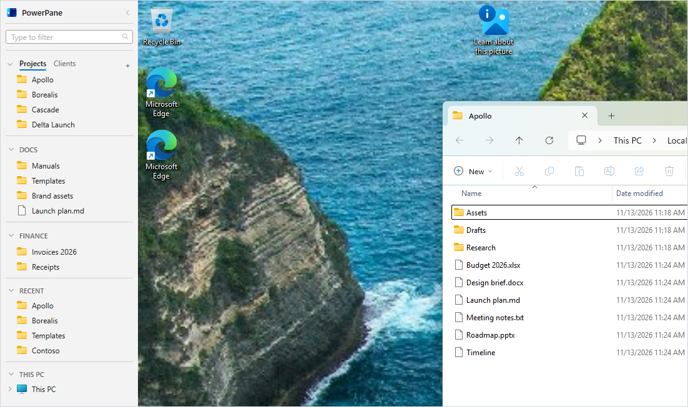

### Open and Save dialog support

PowerPane attaches to file Open and Save common dialogs and honors the same pane mode as real windows. Inside mode shifts every one of the dialog's controls and widens the dialog so nothing overlaps the pane, and beside mode floats a pane against the dialog's edge. Both the classic dialog and the modern common item dialog navigate to the clicked folder.

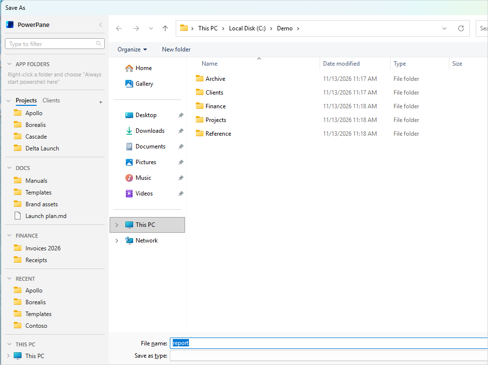

### Search

A box at the top of the pane filters every row beneath it as you type. Because it narrows what is already on screen rather than searching the disk, it stays instant however many groups are pinned.

- A heading disappears along with the rows beneath it
- A folder stays visible when something inside it matches
- Escape clears the box

### Recent Apps

The programs you have been using, where a row opens its app rather than a folder. An app reaches the list either by being brought to the front or by having its Save or Open dialog used, and a setting chooses which of the two count.

- Browser rows open out into that browser's profiles, which are read from the browser's own profile list
- Chromium-family browsers and Firefox are both read
- Programs carry the name and icon Windows shows for them, which tells side-by-side installs such as Chrome and Chrome Canary apart
- The folder an app's dialog was last sent to is on the row's right-click menu

### Per-app folders

Right-click a folder while an app's Save or Open dialog is open and choose "Always start {app} here". That app's dialogs then offer the folder from an App Folders section at the top of the pane, which appears only inside a dialog.

### Keyboard navigation

An optional shortcut moves focus into the pane, where the arrow keys move between folders and Enter opens one. It stays off until it is switched on under Settings, Keyboard, so no key combination is taken from the rest of the system by default.

### Quick switcher

A second optional shortcut, Ctrl+Alt+Space unless you change it, opens a search box over the window in front. Type part of a pin, a Recent folder, a drive, or a quick action, and press Enter. The Explorer window or Open or Save dialog in front goes to that folder, or the action runs against that Explorer window. With neither in front, the folder opens in a new Explorer window. Escape closes the box. Pins rank above Recent folders when both match equally well. The shortcut also stays off until it is switched on under Settings, Keyboard.

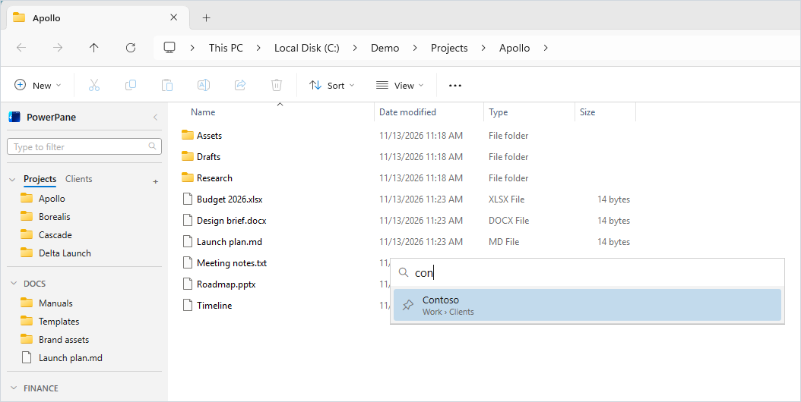

### Profiles

Each profile is an independent workspace with its own groups folder, recents count, and sidebar width.

- Switch profiles from the tray icon's right-click menu or from the profile tab row under the title
- The profile tab row can auto-hide, sliding out when the cursor is over the header
- Manage profiles on the Settings window's Groups & profiles page, with cards for add, rename, and remove
- Move a group to another profile with a destination picker and a "Copy instead of move" checkbox, so one group can live in more than one profile

### Remembered layout

Section headers, groups, and folder subtrees remember whether they are open, keyed by section type, group folder, and tree path. The state survives pane rebuilds, profile switches, window switches, and restarts.

### Collapsible pane and appearance

- A title header with the logo and a chevron collapses the pane to a thin strip, or toggles auto-hide on the desktop dock
- Dark and light themes, applied live
- Adjustable pane width from 160 to 400 px, dragged from the inner edge
- Settings apply live with no Apply button

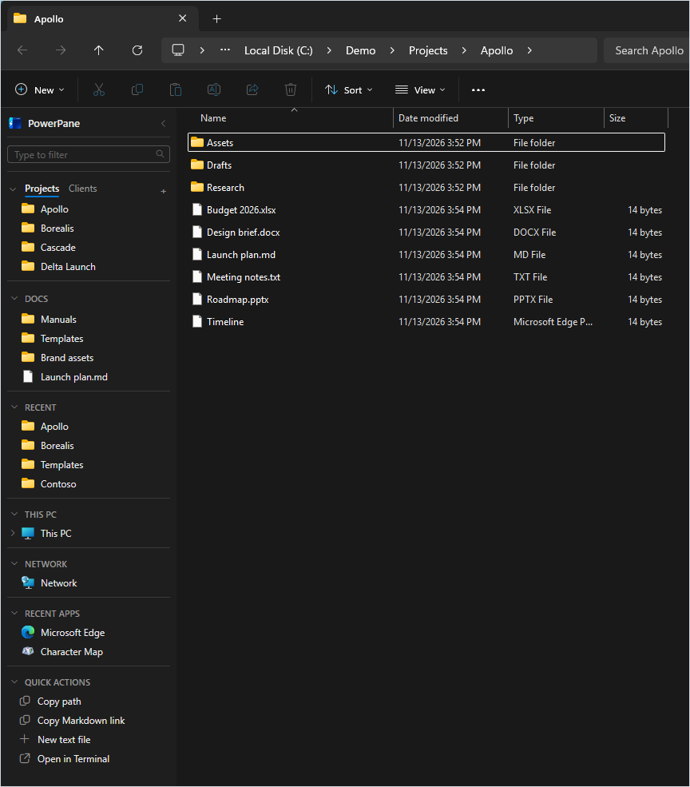

## Requirements

- **Windows 11 or Windows 10**, 64-bit. PowerPane is developed and tested on Windows 11, including in Windows Sandbox. Windows 10 is expected to work, but it is not tested regularly. See [Compatibility](#compatibility).
- **.NET Framework 4.8** runtime (preinstalled on current Windows)
- To build from source: **Visual Studio 2019/2022** with the .NET Framework 4.8 targeting pack
- To build the installer: **[Inno Setup](https://jrsoftware.org/isinfo.php)** 6+

## Installation

### Option A: Run a release build

1. Download `PowerPane-<version>-x64-setup.exe` from the [latest release](https://github.com/prisant-labs/windows-explorer-powerpane/releases/latest), or build it yourself below
2. Run the installer. It installs per-user with no administrator rights, registers the **Add to PowerPane** right-click verb, adds a startup entry, and launches PowerPane. Over an existing PowerPane, it upgrades that install in place.
3. Open any Explorer window and the pane appears inside it

The installer is not code-signed yet, so Windows SmartScreen may warn about it. Each release lists SHA-256 checksums and a build provenance attestation, so you can confirm the file came from this repository. To uninstall, use Settings, Apps. Your data stays in `%APPDATA%\PowerPane` until you delete it.

### Option B: Build from source

```bash
git clone https://github.com/prisant-labs/windows-explorer-powerpane.git
```

**Build the app**

1. Open `PowerPane.sln` in Visual Studio
2. Select the **Release | x64** configuration (x64 only)
3. Build the solution. The executable is produced at `PowerPane\bin\x64\Release\PowerPane.exe`
4. Run `PowerPane.exe`

**Build the installer (optional)**

1. Build the app first, then run `pwsh -File scripts/package.ps1`
2. The single-file `PowerPane-<version>-x64-setup.exe` is produced in `dist\`, beside the zip and `SHA256SUMS.txt`

> `package.ps1` passes the build's folder and version to `Installer.iss`, so it works for `-Configuration Debug` too. Opening `Installer.iss` in Inno Setup and pressing **Compile** packages the `Release\x64` build.

### Recommended: hide Explorer's own navigation pane

PowerPane sits alongside Windows' built-in navigation pane rather than replacing it, so the two will show side by side until you turn the native one off. In any Explorer window, open the **View** tab, click **Navigation pane**, and uncheck **Navigation pane** so PowerPane is the only tree on the left.

## Usage

### Pinning folders

- Right-click any folder or file in Explorer, or a drive in This PC, and choose **Add to PowerPane**, or right-click inside a folder's empty background, or drag a folder into the pane. On Windows 11 the verb is under "Show more options", or press Shift+F10 on the item
- Select several items and choose the verb once. One window opens for all of them
- The window asks for a group and a tab, with "New group..." and "New tab..." to make one on the spot, and remembers your last choice. The Add button pins the items into that tab
- Click a pinned folder to navigate the current Explorer window to it

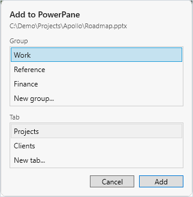

### Groups and tabs

- Drag a group, tab, or pin to reorder it
- Drag one group onto another to merge their tabs
- Drag a tab into empty space to split it into a new group
- Right-click a tab and choose **Sort pins** to order its pins A to Z or by when they were added
- Right-click a group or section header to rename it

### Quick actions and custom commands

Turn on the **Quick actions** section under **Pane sections** in Settings. Then choose its rows on the **Quick actions** page, where you can also reorder them and reset them to their defaults.

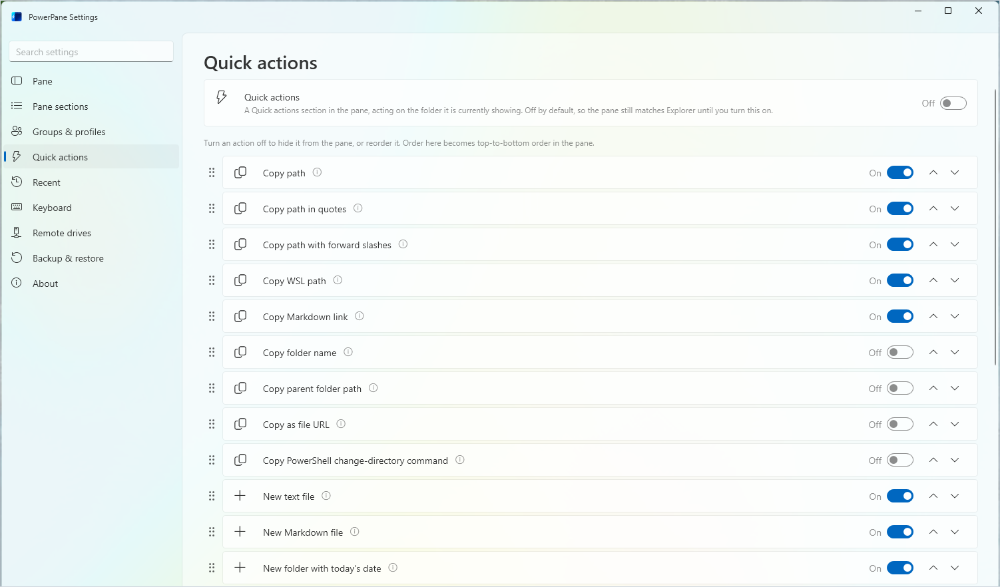

A row acts on the folder on screen, unless its name says "selected". Those rows act on the files selected in Explorer, and say "Nothing selected" when there are none.

To add your own row, give a command a name and a template on the same page. These are invented examples:

| Template | What the row does |
|---|---|
| `code {path}` | Opens the selected item in Visual Studio Code, or the folder when nothing is selected |
| `"C:\Program Files\Git\git-bash.exe" --cd={dir}` | Opens Git Bash in the folder on screen |
| `pwsh -File C:\Demo\tidy.ps1 {paths}` | Runs your script with each selected item as its own argument |
| `C:\Demo\stamp.exe --label={name}` | Runs your program with the selected item's name inside one argument |

The placeholders are `{path}`, `{paths}`, `{dir}`, and `{name}`. Write `{{` and `}}` for literal braces. PowerPane quotes each value, so a folder named `R&D notes` stays one argument.

A placeholder is refused for a program that would read a folder name as code: `cmd`, `wsl`, `wt`, a batch file, PowerShell without `-File`, or `bash -c`. Those programs still work with no placeholder. Quoting cannot make every program safe, so use a placeholder only where the program treats it as a file name, and not after something like `python -c`. Commands in a restored backup arrive turned off.

### Choosing a mode

- Open Settings and pick **Inside**, **Beside**, or **Off** under Pane mode
- Enable the **Desktop dock** for a screen-edge bar that works in any mode

### Profiles

- Switch from the tray menu or the profile tab row under the title
- Add, rename, remove, and move groups between profiles in the Settings window

### Settings

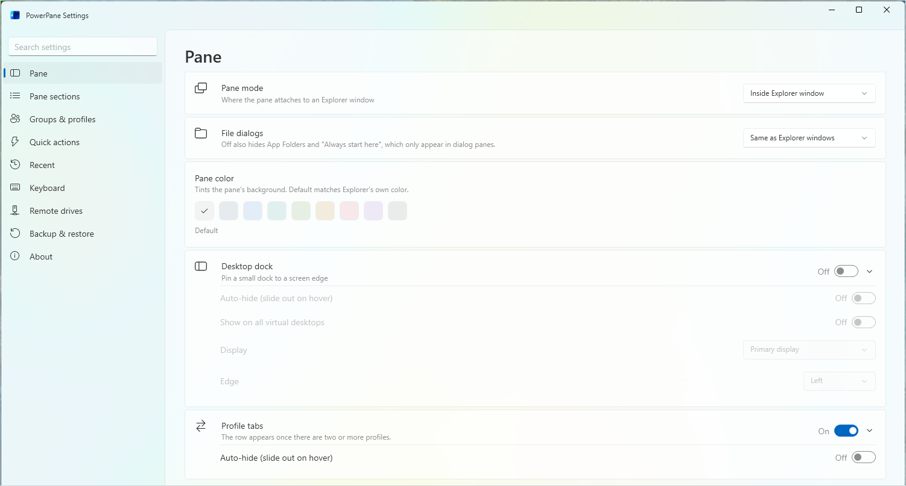

- Open Settings from the tray icon or the gear in the pane
- A navigation pane lists the pages, and a search box jumps to a setting
- Adjust mode, theme, pane width, recents count, section visibility and order, the desktop dock and its options, the profile tab row, folders Recent never shows, which apps Recent Apps lists, the keyboard shortcuts, and profiles
- The About page shows the running version and a short summary of what is new in it, and offers a download when a newer release is published
- Changes apply live

## Settings and data

All data is stored locally under your user profile:

```
%APPDATA%\PowerPane\
├── settings.json        # All settings, sections, dock options, and profiles
├── Groups\              # Groups, tabs, and pinned shortcuts on disk
├── uistate.txt          # Remembered open/closed state of sections, groups, and trees
└── Logs\                # debug.log and events.log, for diagnosis
```

Groups are stored as ordinary folders: a **group** is a folder under `Groups\`, a **tab** is a subfolder, and a **pin** is a `.lnk` shortcut. You can back up, edit, or rearrange the `Groups` tree directly and PowerPane reflects it.

### Privacy

- **No cloud sync**: everything stays on your computer
- **No accounts**: no login or registration
- **No telemetry**: PowerPane sends no usage data, crash reports, or analytics anywhere
- **Readable formats**: a JSON settings file and ordinary Windows shortcuts you can open and back up anywhere

PowerPane makes one network request of its own, an update check:

- **What it sends**: an HTTPS GET to `api.github.com` for the latest release of `prisant-labs/windows-explorer-powerpane`, with the header `User-Agent: PowerPane/<version>`. Like any web request, it shows GitHub your IP address. It sends nothing else.
- **When it runs**: at most once a day, a few minutes after PowerPane starts, and also when you open the About page in Settings or press "Check for updates" there. To stop the daily check, turn off "Check for updates automatically" on the About page. Opening About still checks.
- **What it does with the answer**: when a newer version exists, it shows one notice per version, adds an item to the tray menu, and puts a dot on About in Settings. It never downloads or installs anything. The notice opens the release page in your browser.

Two other features reach the network only when you use them:

- **Links**: the About page's links and the Remote drives page's download buttons open in your default browser when you click them.
- **Remote drives (SSH)**: `sshfs` connects to the servers you enter, when you connect a drive.

### settings.json format

```json
{
  "groupsPath": "%APPDATA%\\PowerPane\\Groups",
  "sections": [
    { "type": "groups",   "visible": true, "order": 0 },
    { "type": "recents",  "visible": true, "order": 1 },
    { "type": "computer", "visible": true, "order": 2 },
    { "type": "network",  "visible": true, "order": 3 },
    { "type": "linux",    "visible": true, "order": 4 }
  ],
  "recentsMaxCount": 15,
  "sidebarWidthPx": 220,
  "mode": "inside",
  "desktopDock": false,
  "desktopDockAutoHide": true,
  "desktopDockAllDesktops": false,
  "profiles": [
    { "name": "Profile 1", "groupsPath": "%APPDATA%\\PowerPane\\Groups", "recentsMaxCount": 15, "sidebarWidthPx": 220 }
  ],
  "activeProfile": 0,
  "showProfileTabs": true,
  "profileTabsAutoHide": false
}
```

## Compatibility

| OS | Supported | Notes |
|----|-----------|-------|
| Windows 11 x64 | ✅ | Developed and tested on, including in Windows Sandbox |
| Windows 10 x64 (incl. LTSC) | ✅ | Expected to work. The original project was developed on Windows 10 LTSC, but PowerPane does not test Windows 10 regularly. Windows 11-only features, such as tabs, are skipped there. |
| Windows 11 on Arm | ⚠️ | The installer accepts it from 3.13.0.0, and Windows runs the x64 build through emulation. Nobody has run PowerPane on an Arm computer yet. |
| Windows 8.1 and Windows 7 | ❌ | Not supported. Both are past Microsoft's end of support, and the Explorer window classes differ. |
| macOS / Linux | ❌ | Windows-only (Win32 + WPF) |

## Troubleshooting

### The pane is not showing in Explorer windows

Make sure Pane mode is **Inside** or **Beside** rather than **Off** in Settings. A new window shows the pane the moment Windows has presented it and laid out its toolbar, so the pane appears on its own without you resizing the window.

### A Save dialog saves to the wrong place when I click a folder

PowerPane navigates file dialogs through the address bar rather than the File name box, so clicking a folder changes the location without committing a save. If a third-party app runs its own custom dialog that fights the inside layout, PowerPane drops that dialog to the non-invasive beside pane automatically.

### An Explorer window looks shifted after PowerPane closes

Closing PowerPane restores each window's content view to full width. If a window was mid-load when PowerPane exited, open a new window and it will be normal.

### Build errors about C# syntax

The project uses the C# 7.3 language version that is the default for .NET Framework 4.8. Build with the .NET Framework 4.8 toolchain rather than retargeting the project to a newer framework.

## How it works

PowerPane is a tray application built on WPF and documented Win32 interop only; it never injects code into `explorer.exe`, so a fault in PowerPane can never bring Explorer down. The core ideas:

- **SetWinEventHook** out of process discovers Explorer folder windows and tracks them as they are created, shown, moved, activated, and destroyed
- **Inside mode** reparents a WPF `HwndSource` as a `WS_CHILD` of the `CabinetWClass` window and shifts Explorer's content host (`ShellTabWindowClass`) to the right. A readiness gate holds the shift until the window is actually presented and its toolbar has laid out, so the pane never flashes blank or sits over the toolbar
- **A short burst, not a constant poll**, holds the split the moment a window opens or is activated, because those are the only times Explorer resets its content to full width. Resize is held purely from location events, so dragging the window edge stays smooth
- **Beside mode** makes the Explorer window the pane's owner via `GWLP_HWNDPARENT`, so Windows keeps the pane at that window's z-level and on its virtual desktop with no manual tracking
- **File dialogs** are detected as a `#32770` carrying a `ComboBoxEx32` (classic comdlg32) or a `SHELLDLL_DefView` (modern common item dialog). Requiring `#32770` is deliberate, because the desktop itself hosts a `SHELLDLL_DefView` and must never be matched
- **The desktop dock** reserves the screen edge with `SHAppBarMessage` and pins itself to every virtual desktop through `IVirtualDesktopManager`
- **Groups on disk** are folders of `.lnk` shortcuts, read and written through the shell `IShellLink`, so the model is just files you can see
- **Settings** serialize to JSON with `DataContractJsonSerializer` using atomic temp-then-replace writes, with migration that upgrades older files in place; remembered open/closed state lives in `uistate.txt`

## Project structure

```
PowerPane/
├── PowerPane.sln              # Visual Studio solution
├── Installer.iss              # Inno Setup installer script
├── CHANGELOG.md               # Version history
├── screens/                   # Screenshots used in this README (taken in Windows Sandbox)
└── PowerPane/
    ├── PowerPane.csproj       # Project (.NET Framework 4.8, x64, WPF)
    ├── app.manifest           # Per-monitor DPI, runs without elevation
    ├── App.xaml(.cs)          # Tray host and service startup
    ├── Interop/
    │   ├── NativeMethods.cs   # All Win32 P/Invoke
    │   ├── WinEventHook.cs    # Out-of-process window-event hooks
    │   ├── ExplorerNavigator.cs # Navigate a real Explorer window
    │   ├── DialogNavigator.cs # Detect and navigate file dialogs
    │   └── VirtualDesktop.cs  # Virtual-desktop queries and pinning
    ├── Explorer/
    │   ├── ExplorerWatcher.cs # Discovers windows, drives layout, burst enforcer
    │   ├── ExplorerWindow.cs  # One embedded (inside) pane and its content shift
    │   ├── ExplorerFollowerWatcher.cs # Beside-mode follower panes
    │   ├── DialogPaneWatcher.cs # Panes for Open/Save dialogs
    │   ├── DialogInsidePane.cs # Inside-mode pane for a dialog
    │   ├── RecentTracker.cs   # Capture real Explorer navigation
    │   ├── AppBarHost.cs      # Desktop dock AppBar
    │   └── MonitorPicker.cs   # Lists and resolves monitors for the dock's Display setting
    ├── Models/
    │   └── Models.cs          # Settings, profiles, and pinned-folder models
    ├── Services/
    │   ├── SettingsStore.cs   # JSON load, save, migrate
    │   ├── GroupStore.cs      # Groups, tabs, and pins on disk
    │   ├── UiState.cs         # Persistent open/closed state
    │   ├── RecentFoldersService.cs # Recent list model
    │   ├── DriveService.cs    # Drive and tree enumeration
    │   ├── KnownFolders.cs    # Known-folder resolution
    │   ├── ShellLink.cs       # Read and write .lnk shortcuts
    │   ├── FileDropOps.cs     # Shell move/copy/shortcut drops
    │   ├── ThemeService.cs    # Dark / light theming
    │   ├── FluentThemeService.cs # Ported Fluent theme, scoped to the Settings window
    │   ├── QuickActionLibrary.cs # The built-in quick actions and their defaults
    │   ├── QuickActionRunner.cs  # Runs a quick action
    │   ├── CustomCommandTemplate.cs # Custom command templates: placeholders, quoting, refusals
    │   ├── UpdateService.cs   # Asks GitHub for the latest release
    │   ├── UpdateNotifier.cs  # The daily check and the one-time notice
    │   ├── WhatsNew.cs        # The version summary on the About page
    │   └── Log.cs
    ├── Themes/Fluent/         # Ported Microsoft WPF Fluent theme (see NOTICE.md below)
    └── UI/
        ├── SidebarControl.xaml(.cs)  # The pane shell
        ├── GroupSection.xaml(.cs)    # A group with its tabs
        ├── ComputerSection.xaml(.cs) # This PC, drives, trees
        ├── RecentsSection.xaml(.cs)  # Recent folders
        ├── ShellRootSection.cs       # Network and Linux roots
        ├── FolderItem.xaml(.cs)      # One folder row
        ├── FolderTreeNode.cs         # A lazy tree node
        ├── LazyContextMenu.cs        # Builds a pinned row's menu when it opens
        ├── Settings/                 # The native Settings window, its cards, and its pages
        ├── GroupPickerWindow.xaml(.cs) # The Add to PowerPane picker: group, tab, and items
        ├── TextPrompt.cs             # Top-level prompts for text entry
        ├── DropLineAdorner.cs        # Reorder drop line
        └── DragGhostAdorner.cs       # Drag ghost
```

## Contributing

1. Fork the repository
2. Create a feature branch (`git checkout -b feature/amazing-feature`)
3. Make your changes (keep to documented Win32 and the existing C# 7.3 / .NET Framework 4.8 target)
4. Build and test on Windows 10 or 11
5. Commit your changes (`git commit -m 'Add amazing feature'`)
6. Push to the branch (`git push origin feature/amazing-feature`)
7. Open a Pull Request

## License

MIT, see the [LICENSE](LICENSE) file for details. The license keeps the original project's copyright notice, as MIT requires.

### Third-party code

The Settings window's visual style (`PowerPane/Themes/Fluent/`) is ported from Microsoft's WPF Fluent theme (`dotnet/wpf`, MIT), itself built from the open-source [WPF-UI](https://github.com/lepoco/wpfui) project. See [`PowerPane/Themes/Fluent/NOTICE.md`](PowerPane/Themes/Fluent/NOTICE.md) for the source commit, the ported files, and both copyright notices.

---

**⭐ If PowerPane made Explorer feel like home, please star the repository!**

---

*Made with ❤️ for people who live in File Explorer.*
